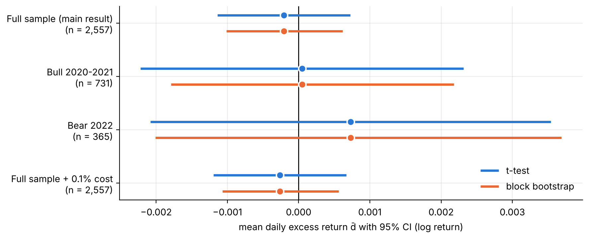
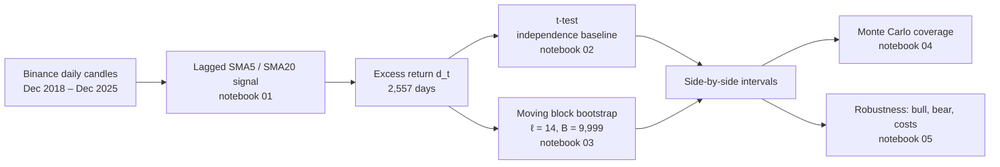
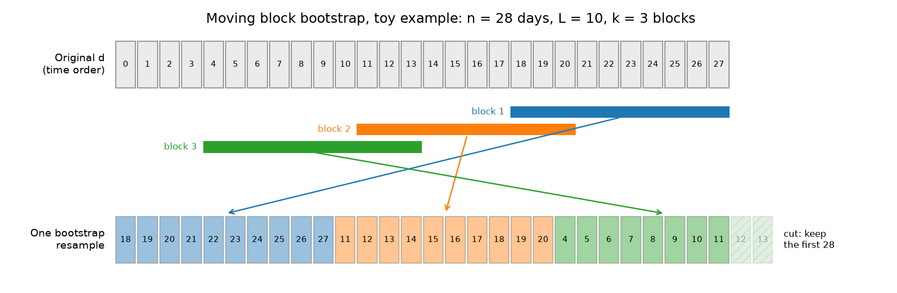
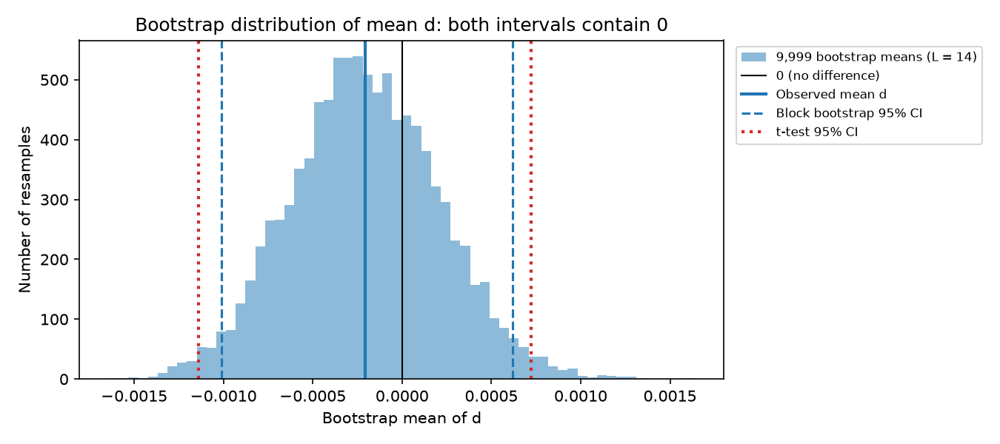
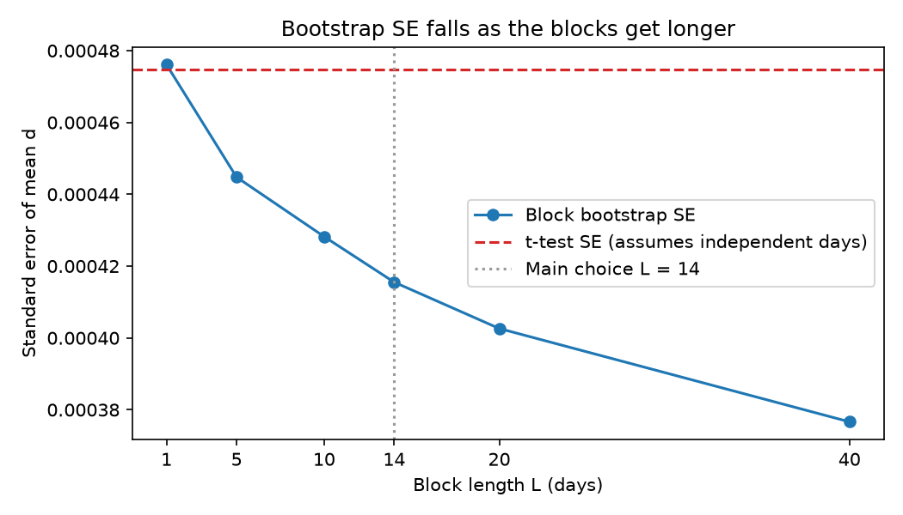
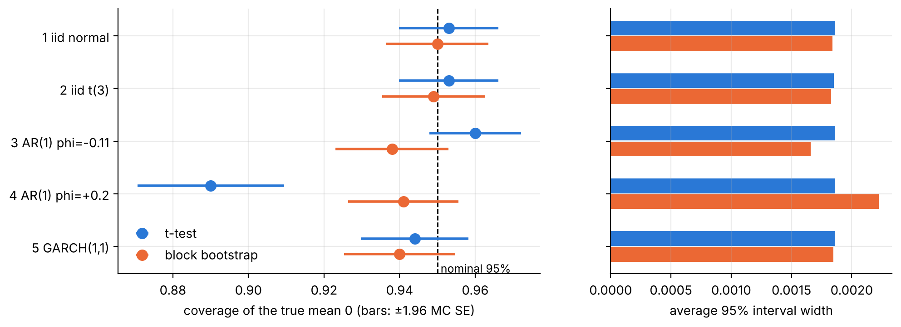
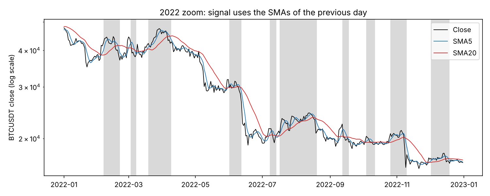
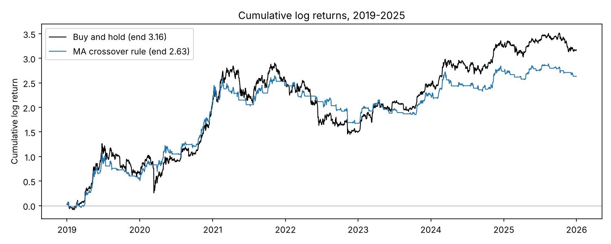
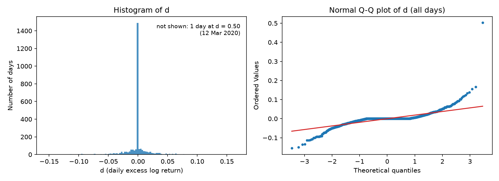
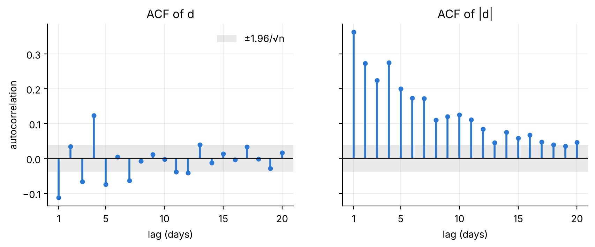

<div align="center">

# Does a Moving-Average Rule Beat Buy-and-Hold on Bitcoin?

**Statistical inference on a pre-registered 5/20-day crossover rule, 2019–2025**


*DS607 Statistics for Data Science · Singapore Management University · AY2026/27 August Term*<br>
**Zhang Enhao · Ma Tianjiao · Deng Shenbojia**

</div>

---

> [!IMPORTANT]
> **Short answer: no detectable edge.** Over 2,557 days the rule's mean daily excess return over buy-and-hold is −0.021% (about −7.6% a year in log terms). The t-test (p = 0.66) and the moving block bootstrap (p = 0.62) both place zero well inside the 95% interval, and so does every pre-registered robustness case.

<p align="center">
  
</p>

<div align="center">

| | t-test (independent days) | Moving block bootstrap (ℓ = 14) |
| :-- | :--: | :--: |
| Mean daily excess return $\bar d$ | −0.000208 | −0.000208 |
| Standard error | 0.000475 | 0.000416 |
| 95% confidence interval | [−0.00114, 0.00072] | [−0.00101, 0.00062] |
| p-value, $H_0: \mu_d = 0$ | 0.662 | 0.618 |

</div>

<details>
<summary><b>Contents</b></summary>

1. [Question and motivation](#1--question-and-motivation)
2. [Pre-registered design](#2--pre-registered-design)
3. [Data](#3--data)
4. [Methods](#4--methods)
5. [Results](#5--results)
6. [Limitations](#6--limitations)
7. [Reproduce](#7--reproduce)
8. [Repository map](#8--repository-map)
9. [Team, contributions and AI use](#9--team-contributions-and-ai-use)

</details>

---

## 1 · Question and motivation

> *Does a pre-specified 5-day / 20-day moving-average crossover rule applied to Bitcoin daily prices produce a mean daily excess return over buy-and-hold that is statistically distinguishable from zero?*

The moving-average crossover is one of the most widely quoted rules in technical analysis, and a backtest of it almost always shows *some* gap against buy-and-hold. The question is whether that gap is signal or noise. Bitcoin returns make the answer harder than it looks: they are heavy-tailed, their volatility clusters, and the rule's daily excess return is serially correlated, so the textbook t-test's independence assumption fails.

We treat the rule as **one fixed hypothesis**, not a strategy to optimise, and compare two ways of putting an interval around its mean excess return:

- an **independence-based t-test**, the classical baseline, and
- a **moving block bootstrap** that keeps the serial dependence.

A Monte Carlo study then shows when each interval can be trusted, and three pre-registered robustness cases check that the answer does not hinge on the sample.

Following Prof Qiu's guidance on our topic note (17 Sep 2026), the project stays on statistical inference, treats the ordinary t-test as the independence-based baseline, and documents every implementation step of the block bootstrap.

## 2 · Pre-registered design

Every parameter lives in [`src/config.py`](src/config.py) and was committed on 21 Oct 2026, before any inference was run. Nothing was tuned on the data.

| Parameter | Value |
| :-- | :-- |
| Instrument / frequency | BTCUSDT spot, daily candles cut at 00:00 UTC |
| Sample | 1 Jan 2019 – 31 Dec 2025, **2,557 daily returns**; Dec 2018 only warms up the averages |
| Rule | SMA5 vs SMA20 on closes, signal lagged one day; zero return when out of the market |
| Block length | main result ℓ = round(n^(1/3)) = **14**; sensitivity ℓ ∈ {1, 5, 10, 20, 40} |
| Bootstrap | B = 9,999 resamples, seed 607 |
| Sub-periods | bull 2020–2021; bear 2022 |
| Transaction cost | 0.1% per position switch (Binance standard taker fee) |
| Test | two-sided, 5% level |

**Deviations from plan:** none. `src/config.py` is unchanged since commit `7afe1ef`.

## 3 · Data

| | |
| :-- | :-- |
| **Source** | Binance public REST API, `GET /api/v3/klines` (fallback `data-api.binance.vision`) |
| **Series** | BTCUSDT spot, daily OHLCV; all 12 raw fields kept |
| **Window pulled** | 1 Dec 2018 – 31 Dec 2025, 2,588 candles in 3 paged requests |
| **Pulled** | 22 Oct 2026, 06:46 UTC — exact URLs in [`data/raw/PULL_LOG.md`](data/raw/PULL_LOG.md) |
| **Time zone** | candles open at 00:00 UTC, so each "day" closes at 08:00 Singapore time |
| **Checks** | 2,588 rows, no duplicate or missing days, all closes positive (asserted on every load) |
| **Licence** | public market data; no account, API key or SMU-licensed database involved, so the raw file is committed |

## 4 · Methods



### 4.1 The rule and the excess return

With daily log return $r_t = \ln(C_t / C_{t-1})$, the position for day $t$ uses only the averages of day $t-1$:

```math
s_t = \mathbf{1}\{\mathrm{SMA}_5(t-1) > \mathrm{SMA}_{20}(t-1)\}, \qquad
d_t = s_t r_t - r_t = -(1 - s_t)\, r_t .
```

On every day the rule holds BTC, $d_t$ is exactly zero, so 55.4% of the observations sit on a single spike at zero. A perturbation test confirms there is no look-ahead: changing a day's close leaves that day's signal unchanged.

### 4.2 Classical baseline: the t-test

$t = \bar d / (s / \sqrt n)$ with a $t_{n-1}$ interval. It assumes the $d_t$ are independent and identically distributed with finite variance. For a stationary series the variance of the mean is really

```math
\operatorname{Var}(\bar d) \approx \frac{\sigma^2}{n}\Big(1 + 2\sum_{k \ge 1} \rho_k\Big),
```

so what matters for the interval is the **linear autocorrelation of $d$ itself**. Volatility clustering and heavy tails alone do not bias the t-test's standard error in a sample this large.

### 4.3 Moving block bootstrap

<p align="center">
  
</p>

1. Draw $k = \lceil n/\ell \rceil = 183$ block starts uniformly from $\lbrace 0, \dots, n-\ell \rbrace$.
2. Take $\ell = 14$ consecutive days from each start, so short-range dependence survives inside every block.
3. Concatenate the blocks, cut to $n$ days (no wrap-around), and record the mean. Repeat $B = 9{,}999$ times.
4. Report the 2.5% and 97.5% percentiles as the interval. For the test, centre the bootstrap means at zero:

```math
p = \frac{1 + \#\{\,|\bar d^{*}_b - \bar d| \ge |\bar d|\,\}}{B + 1}.
```

The implementation is plain NumPy ([`src/bootstrap.py`](src/bootstrap.py)), so every step above maps to a line of code. With ℓ = 1 it reduces to the ordinary i.i.d. bootstrap and reproduces the t-test's standard error (0.000476 vs 0.000475).

### 4.4 Monte Carlo coverage check

Five data-generating processes with **true mean zero**, n = 2,557, SD matched to $d$ (0.024), R = 1,000 replications each: i.i.d. normal, i.i.d. $t_3$, AR(1) with φ = −0.11 (our data's lag-1 autocorrelation), AR(1) with φ = +0.2, and GARCH(1,1). We count how often each 95% interval covers zero.

## 5 · Results

### 5.1 Main result

<p align="center">
  
</p>

Zero sits in the middle of the bootstrap distribution, far from either tail. The rule held BTC on 55.4% of days and switched position 143 times. It finished behind buy-and-hold (cumulative log return 2.63 vs 3.16), but a gap of that size is well within what chance produces.

### 5.2 Why the bootstrap interval is *narrower*

$d$ has a **negative** lag-1 autocorrelation (ρ₁ = −0.11; Ljung–Box at lag 10 rejects independence, p < 10⁻¹⁸). Negative dependence makes the i.i.d. standard error too large, so the honest interval is tighter, not wider. Two independent routes agree:

| Route | Standard error | vs t-test |
| :-- | :--: | :--: |
| t-test (assumes independence) | 0.000475 | — |
| Variance-factor formula, Bartlett weights, K = 14 | 0.000407 | −14% |
| Moving block bootstrap, ℓ = 14 | 0.000416 | −12% |

<table>
<tr>
<td width="50%"></td>
<td width="50%">

| ℓ | Bootstrap SE | p |
| :--: | :--: | :--: |
| 1 | 0.000476 | 0.661 |
| 5 | 0.000445 | 0.638 |
| 10 | 0.000428 | 0.624 |
| **14** | **0.000416** | **0.618** |
| 20 | 0.000403 | 0.604 |
| 40 | 0.000377 | 0.579 |

The conclusion does not depend on the block length.

</td>
</tr>
</table>

### 5.3 When does the t-interval fail?

<p align="center">
  
</p>

| Data-generating process | t-test coverage | Theory | Block bootstrap coverage |
| :-- | :--: | :--: | :--: |
| i.i.d. normal | 95.3% | 95% | 95.0% |
| i.i.d. $t_3$ (heavy tails only) | 95.3% | 95% | 94.9% |
| AR(1), φ = −0.11 | 96.0% | 97.1% | 93.8% |
| AR(1), φ = +0.2 | **89.0%** | 89.0% | 94.1% |
| GARCH(1,1) (volatility clustering only) | 94.4% | 95% | 94.0% |

Heavy tails and volatility clustering leave the t-interval intact. **Positive** autocorrelation is what breaks it (89% instead of 95%), and the block bootstrap repairs most of the gap. Monte Carlo standard error is about 0.7 percentage points.

### 5.4 Robustness

| Case (fixed in the proposal) | n | t-test 95% CI | p | Block bootstrap 95% CI | p |
| :-- | :--: | :--: | :--: | :--: | :--: |
| Full sample (main result) | 2,557 | [−0.00114, 0.00072] | 0.662 | [−0.00101, 0.00062] | 0.618 |
| Bull 2020–2021, ℓ = 9 | 731 | [−0.00222, 0.00232] | 0.967 | [−0.00179, 0.00218] | 0.964 |
| Bear 2022, ℓ = 7 | 365 | [−0.00208, 0.00354] | 0.610 | [−0.00201, 0.00369] | 0.619 |
| Full sample + 0.1% cost per switch | 2,557 | [−0.00119, 0.00067] | 0.579 | [−0.00107, 0.00056] | 0.525 |

Every interval contains zero. These are robustness checks, not separate findings, so no multiple-testing claim is made on them.

<details>
<summary><b>More figures: price and signal, cumulative returns, distribution and autocorrelation of d</b></summary>
<br>






One day dominates the right tail: on 12 March 2020 BTC fell about 40% (log return −0.50) while the rule was in USDT, giving d = +0.50. Excess kurtosis of d is 83 and skewness 3.5.

</details>

## 6 · Limitations

| | |
| :-- | :-- |
| **One exchange** | Binance BTCUSDT only; other venues and pairs may differ |
| **One rule** | 5/20-day crossover only; the result says nothing about other rules |
| **Regime dependence** | yearly means change sign; two sub-periods cannot rule out regime effects |
| **Block length** | ℓ = 14 is a rule of thumb; sensitivity from 1 to 40 leaves the conclusion unchanged |
| **Bootstrap accuracy** | under negative autocorrelation the block bootstrap slightly under-covers (93.8% in simulation) |
| **Costs** | flat 0.1% per switch; no slippage, spread or funding |
| **Sample window** | 2019–2025 only |

## 7 · Reproduce

```bash
git clone https://github.com/CuriousAndy/ds607-btc-ma-crossover-inference.git
cd ds607-btc-ma-crossover-inference
python -m venv .venv && source .venv/bin/activate   # Windows: .venv\Scripts\activate
pip install -r requirements.txt
jupyter nbconvert --to notebook --execute --inplace notebooks/0*.ipynb
```

- Python 3.12; package versions are pinned in [`requirements.txt`](requirements.txt).
- The raw data is committed, so no network access is needed. If `data/raw/` is empty, notebook 01 pulls it from Binance first.
- Run time: about 2–3 minutes for notebook 04 (the simulation), under 30 seconds for each of the others.
- All randomness comes from `np.random.default_rng(607)`, so every number above reproduces exactly.

## 8 · Repository map

```
├── src/
│   ├── config.py        pre-registered parameters
│   ├── data.py          pull and load Binance daily candles, with integrity checks
│   ├── strategy.py      returns, lagged signal, excess return d, costs
│   ├── classical.py     t-test, CLT interval, variance-factor helpers
│   └── bootstrap.py     moving block bootstrap: indices, means, interval, test
├── notebooks/
│   ├── 01_data_rule_eda.ipynb          data checks, rule, descriptive statistics
│   ├── 02_classical_baseline.ipynb     t-test baseline and its assumptions
│   ├── 03_block_bootstrap.ipynb        implementation, main result, sensitivity
│   ├── 04_monte_carlo_coverage.ipynb   coverage on simulated data
│   └── 05_robustness.ipynb             sub-periods and transaction costs
├── data/raw/            raw candles + pull log
├── outputs/
│   ├── figures/         every figure in this README
│   ├── tables/          every table, as CSV
│   └── presentation/    slide deck (PDF)
└── docs/proposal.pdf    one-page project proposal
```

## 9 · Team, contributions and AI use

| Member | Role |
| :-- | :-- |
| **Zhang Enhao** (leader) | research design, proposal, pre-registration, repository architecture, review of every node, integration |
| **Deng Shenbojia** | data pipeline, trading rule, descriptive statistics, moving block bootstrap |
| **Ma Tianjiao** | t-test baseline, Monte Carlo coverage study, robustness |

Full breakdown in [`CONTRIBUTIONS.md`](CONTRIBUTIONS.md). Every use of generative AI, and how its output was checked, is logged in [`AI_USAGE.md`](AI_USAGE.md).

<div align="center">
<sub>This repository is group work for DS607 in the SMU MDSE programme. Market data from the Binance public API.</sub>
</div>
